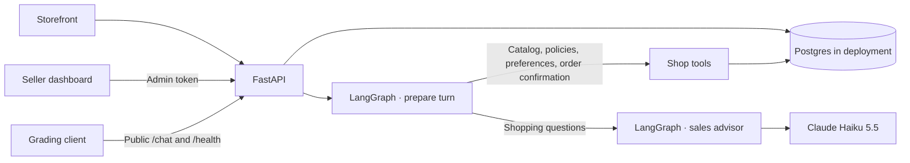

# Grove Supply · ShopBot

A storefront and sales assistant for a small seller. Shoppers can browse live inventory, compare products, check store policies, save preferences, and confirm a demo order. The seller dashboard shows inventory, order counts, and subtotals.



## Run locally

Use Python 3.11 or later. Run from the repository root.

```powershell
python -m pip install -r requirements.txt
Copy-Item .env.example .env
python -m uvicorn server:app --host 127.0.0.1 --port 8000
```

Before launching, set your group’s `ANTHROPIC_API_KEY` and a strong `SHOPBOT_ADMIN_TOKEN` in the ignored `.env`. The default model is `claude-haiku-5-5`. If this repository is directly inside the Workshop workspace, ShopBot can also read the existing group credentials from the parent workspace’s `.env`.

Open [the storefront](http://127.0.0.1:8000/) and [the seller dashboard](http://127.0.0.1:8000/admin). The dashboard requires the configured token. Use `/catalog`, `/shipping`, and `/returns` for quick lookups. Use `/remember recycled paper` and `/preference` to try memory across chats. To try a demo order, select **Order** on a product and confirm in the chat. Each confirmation updates stock and creates an order. The demo collects no payments.

## Grading API

- `GET /health` returns plain text `ok`.
- `POST /chat` accepts `{"user_id":"example-shopper","thread_id":"example-thread","message":"/catalog"}`. It returns `{"reply":"…","tool_calls":[…],"tokens":{"in":0,"out":0}}`. Both endpoints are open for the grader. Deterministic tool turns report zero model tokens.

## Memory and access

Short-term memory keeps the last six user-assistant turns and any open order confirmation under the composite key `(user_id, thread_id)`. Long-term memory stores a shopper’s explicitly saved shopping preference by `user_id`. Products, confirmed orders, conversations, and preferences persist in Postgres in deployment. Local development defaults to file-backed SQLite.

The storefront generates an opaque user ID per browser profile and a fresh thread ID per chat. The grading API trusts the supplied IDs by design. Data queries are scoped to those IDs, but callers who know someone’s ID can impersonate them through the public API. Keep the public demo free of private shopper information. Store-wide data is protected by a separate admin token.

## Deployment

1. Create a Neon or Supabase Postgres database. Use its TLS-enabled connection string for `DATABASE_URL`. The service creates and seeds its tables on startup.
2. Create a Docker web service on Render with the repository root as the root directory. Set `DATABASE_URL`, `ANTHROPIC_API_KEY`, `ANTHROPIC_MODEL`, and `SHOPBOT_ADMIN_TOKEN` through the host’s secret settings. The Docker image requires Postgres and listens on the host-supplied port. Verify `GET /health` on the public API host before proceeding. Free instances go idle after 15 minutes, so allow for a cold start when checking the grading URL. [Render free service documentation](https://render.com/docs/free)
3. Copy `web/vercel.json.example` to `web/vercel.json` and replace `https://YOUR-API-HOST` with the deployed API origin. Import the project on Vercel with `web` as the root, **Other** as the framework, and a blank build command. Test both pages and a full order from the deployed website. [Vercel rewrite reference](https://vercel.com/docs/routing/rewrites)

## Local benchmark

The [10 grading scenarios](tests.json) cover product questions, policies, memory, isolation, safety, and confirmation.

| Check | Verification |
| --- | --- |
| Storefront, dashboard shell, catalog, and health | HTTP 200 on localhost |
| Same-thread product recall | Live Claude retrieved the Field Tote and its $29 price |
| Off-topic refusal | Live Claude declined the calculus question |
| API shape, catalog, policies, and injection refusal | Local API integration checks |
| Cross-thread memory and user isolation | Verified on the local API with distinct shopper IDs |
| Confirmation, stock, and seller metrics | Local API tested confirmation scope and replay |
| Hosted Postgres and public deployments | Pending hosted setup |

## Demo and submission

The live URLs, demo GIF, shareable video, and paper canvas link are pending.
